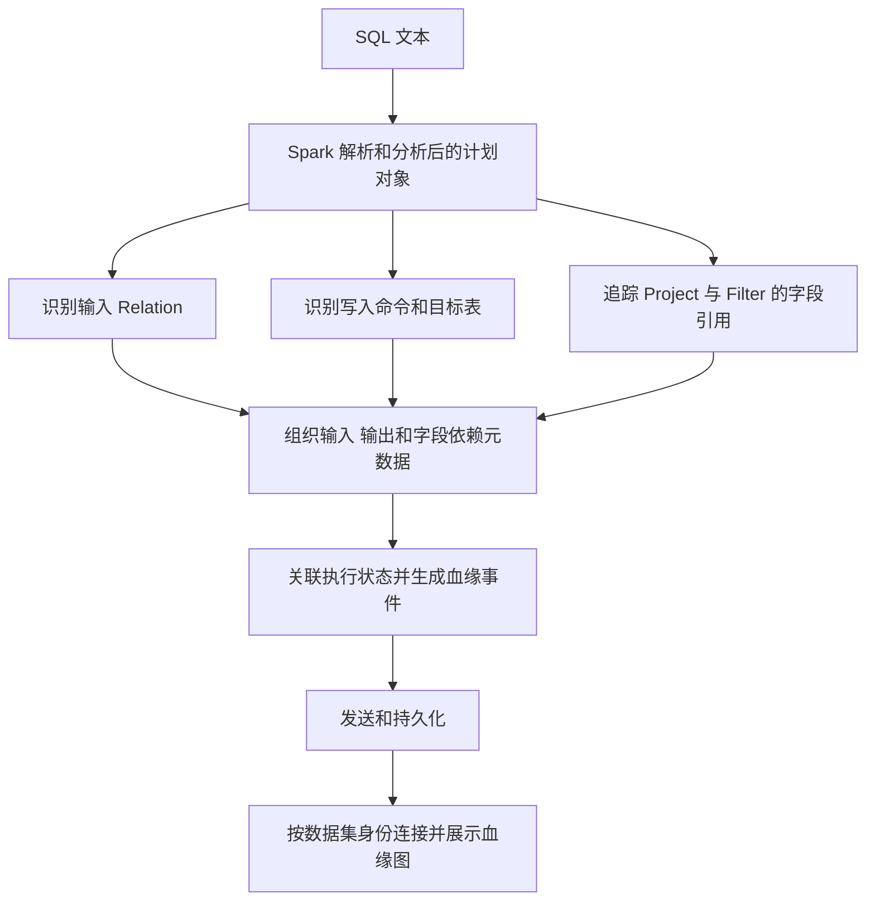
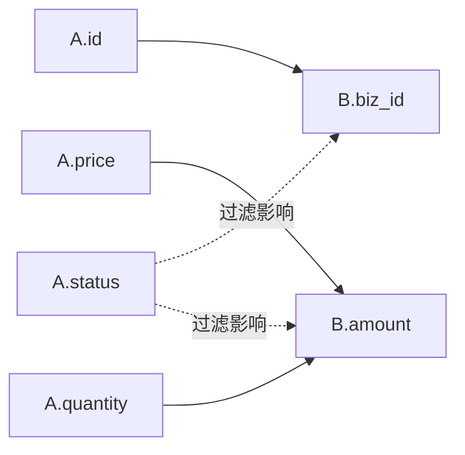

# Spark SQL 血缘机制与多 SQL 分析边界

> 核对日期：2026-10-26。源码基线：Apache Spark 3.5.6，经典 SparkSession 路径。
> 本文讨论普通批处理 SQL、表、逻辑视图与常见血缘采集方式。Spark Connect、流处理以及厂商扩展需要结合各自实现验证。

**阅读重点：第 3.3–3.8 节逐步展示“从计划对象生成血缘”；第 5.4 节给出 OpenLineage 真正负责生成血缘的源码；第 8.4 节附有本次实测代码、计划、JSON 和检查结果。**

## 1. 先回答最关心的问题

**同一个 SparkSession 中，多次调用 `spark.sql(...)`，通常分别解析和分析各自的 SQL，形成各自的查询计划。Spark 核心不会仅因为这些 SQL 属于同一个 Session，就自动把它们拼成一张长期保存的表血缘图。**

例如：

```sql
-- 第一次调用 spark.sql
INSERT INTO B SELECT * FROM A;

-- 第二次调用 spark.sql
INSERT INTO C SELECT * FROM B;
```

业务上的表依赖是 `A → B → C`。但是，第二条 SQL 通常把已落地的普通表 B 作为输入，不会自动把“之前由 A 写入 B”的查询计划接进来。

血缘采集系统可以分别记录 `A → B`、`B → C`，再根据 B 的统一身份连接它们。**这里连接的是跨执行的元数据记录，不是 Spark 把两次执行变成了一个查询计划。**

另一个需要区别的情况是视图：

```sql
CREATE TEMP VIEW V AS SELECT * FROM A;
SELECT * FROM V;
```

查询 V 时，当前查询会引用并解析 V 保存的定义，因此可以在计划中继续看到 A。这属于定义展开，不能解释为自动拼接 Session 中的历史 SQL。

本文关于“不会自动合并历史表血缘”的结论，是结合后面的官方源码调用链和对象解析方式得出的推论，不是官方文档中的一句原文。

## 2. “血缘”至少有三个层面

| 层面 | 回答的问题 | 典型信息 | 主要用途 |
| --- | --- | --- | --- |
| RDD 计算血缘 | 这个 RDD 怎样从父 RDD 计算出来？ | 父 RDD、转换和分区依赖 | 调度及丢失分区的重计算 |
| SQL 查询计划中的依赖 | 当前查询读了什么、做了什么变换、写到哪里？ | Relation、Project、Filter、Join、写入节点 | 分析、优化与执行查询 |
| 数据治理中的表级、字段级血缘 | 哪张表、哪个字段由哪些上游加工产生？ | 数据集、字段、任务、运行及依赖边 | 影响分析、溯源和治理 |

Spark SQL 的计划为提取血缘提供了依据，但计划本身不等于一个跨应用、可长期查询的数据治理系统。Spark 的 RDD 容错能力，也不能直接等同于自动保存数据库表的历史血缘。

官方参考：[RDD 编程指南][rdd-guide]、[EXPLAIN 文档][explain-doc]。

## 3. Spark 从 SQL 中怎样确定依赖

### 3.1 先解析语法，再解析表和字段

以这条 SQL 为例：

```sql
INSERT INTO B
SELECT id, price * quantity AS amount
FROM A
WHERE status = 'paid';
```

可以把处理过程概括为：

```text
SQL 文本
   ↓ Parser：识别 SELECT、FROM、WHERE、INSERT 等语法结构
未解析的逻辑计划
   ↓ Analyzer：根据 Catalog 和会话环境解析表、字段与表达式
分析后的逻辑计划
   ↓ Optimizer：改写和优化计划
优化后的逻辑计划
   ↓ 物理规划与执行
```

从计划中可以识别输入 A、输出 B、投影表达式与过滤条件。Spark 确定依赖的依据是这些显式引用，而不是比较 A、B 的字段名称、执行时间或数据内容。

`EXPLAIN EXTENDED` 可以输出上述多个阶段的计划；官方文档明确区分了 parsed、analyzed、optimized logical plan 和 physical plan。[来源：EXPLAIN][explain-doc]

### 3.2 表级关系和字段级关系并不完全一样

上例的表级数据流是：

```text
A → B
```

若按目标表列顺序将 `id`、`amount` 写入 B，直接的字段值来源是：

```text
A.id                    → B.id
A.price、A.quantity     → B.amount
```

`A.status` 决定哪些记录进入结果，但不是 `B.amount` 数值表达式的直接输入。因此，字段血缘模型应区分“参与计算字段值”和“通过过滤、连接等影响结果”。不同采集器的展示口径可能不同。

OpenLineage 的 Spark 字段血缘实现会遍历逻辑计划，利用表达式的 `ExprId` 追踪输入、输出和表达式依赖，并区分直接、间接影响。这里介绍的是 **OpenLineage 如何提取字段血缘**，不代表 Spark 核心内置了相同的治理血缘输出接口。[来源：OpenLineage 字段血缘][ol-column]

### 3.3 血缘真正是在什么地方“生成”的？

**对表级、字段级治理血缘来说，关键步骤是采集器把 Spark 的计划对象转换成“数据集、字段、运行、依赖边”等元数据。** 只打印 `EXPLAIN`，还没有完成这个转换。

完整过程可表达为：



其中，Spark 提供查询计划和执行机制；采集器负责理解计划、生成元数据；血缘后端负责保存和关联。正式采集器可以根据需要读取分析计划、优化计划或执行相关节点，并补偿缓存等情况。本文最小示例读取 `analyzed()`，用于清楚展示依赖提取。

### 3.4 用一个实际运行的 SQL 看原始材料

本次实验的源表 A 包含 `id、price、quantity、status`，目标表 B 包含 `biz_id、amount`。实际执行的 SQL 为：

```sql
INSERT INTO B
SELECT id AS biz_id, price * quantity AS amount
FROM A
WHERE status = 'paid';
```

下面根据本次[原始分析计划](evidence/R1-analyzed-plan.txt)缩短了数据库限定名，并省略文件路径等信息；`#8` 等数字来自此次运行：

```text
InsertIntoHadoopFsRelationCommand ... 目标表 B ... [biz_id, amount]
+- Project [id#8 AS biz_id#4, (price#9 * quantity#10) AS amount#5]
   +- Filter (status#11 = paid)
      +- SubqueryAlias A
         +- Relation A[id#8,price#9,quantity#10,status#11] parquet
```

这棵树已经包含了生成血缘需要的三类信息：

| 信息 | 从哪里取 | 此次取到的值 |
| --- | --- | --- |
| 输入数据集及输入字段 | `LogicalRelation.catalogTable()`、`output()` | A；`id#8、price#9、quantity#10、status#11` |
| 输出数据集 | 写入命令的 `catalogTable()` | B |
| 输出字段的来源 | 查询输出、`Project.projectList()` 及表达式引用 | `biz_id#4` 引用 `id#8`；`amount#5` 引用 `price#9、quantity#10` |
| 结果行的筛选条件 | `Filter.condition()` 及其引用 | `status#11 = 'paid'` |

目标表是从实际写入节点取得的，源表是从读取关系取得的；不是通过字符串里出现了 A、B 两个名称就直接连线。

### 3.5 第一步：生成表级依赖边

在这个单目标、单输入的示例中：

```text
输入 Relation  → 输入数据集 A
写入 Command   → 输出数据集 B
同一次写入     → 建立直接表依赖 A → B
```

对应最小示例的关键代码如下。`analyzed` 是实际的 JVM 计划对象；`dataset_name` 从表元数据取得限定名：

```python
target = dataset_name(analyzed.catalogTable().get())
query = analyzed.query()

# 遍历 query，遇到 LogicalRelation 时：
source = dataset_name(node.catalogTable().get())
inputs.add(source)

# 当前写入完成后，形成可保存的边：
table_edges = [{"from": source, "to": target} for source in sorted(inputs)]
```

这段代码是便于说明的摘录，完整可运行版本见 [generate_lineage_demo.py](generate_lineage_demo.py)。对于分区写入、多目标写入、Merge、不同 Catalog 和数据源，必须采用相应规则，不能把上述单表例子直接当成通用算法。

如果只是 `SELECT * FROM A`，仍能提取查询输入 A，但没有“写入普通表 B”的节点，因而不能凭空生成 `A → B`。后端可以另外保留“A 被某次查询读取”的运行关系。

### 3.6 第二步：通过表达式引用生成字段依赖

采集器先建立“表达式身份到源字段”的映射：

```text
#8  → A.id
#9  → A.price
#10 → A.quantity
#11 → A.status
```

再读 Project 中每个表达式的引用，得到“输出表达式到输入表达式”的映射：

```text
biz_id#4 → id#8
amount#5 → price#9、quantity#10
```

最后，结合当前写入的目标列映射，把查询输出关联到 B 的字段：

```text
B.biz_id → 查询输出 biz_id#4 → id#8                → A.id
B.amount → 查询输出 amount#5 → price#9、quantity#10 → A.price、A.quantity
```

按“上游指向下游”的展示方向，就是：



本次最小示例读取实际表达式对象的关键代码为：

```python
for expression in scala_seq(node.projectList()):
    output_id = expr_id(expression.toAttribute())
    refs = {
        expr_id(attr)
        for attr in scala_seq(expression.references().toSeq())
    }
    if refs != {output_id}:
        dependencies.setdefault(output_id, set()).update(refs)
```

字段被改名为 `biz_id` 仍能追溯到 `A.id`，因为连接依据是表达式引用，不是两个字段名相同。遇到多层别名或 Cast，继续沿表达式依赖向上追踪，直到源表字段。

**注意：`ExprId` 用于当前计划中的表达式连接，不是跨任务的数据集或字段永久 ID。** 上面只显示了数字部分以便阅读；示例代码实际保留了 `ExprId` 中的 JVM UUID。跨 SQL 拼接时应使用统一的数据集和字段身份。

目标列的对齐也不能一律按名称猜测。本次 INSERT 的分析计划已经完成目标列与查询输出的对齐，最小示例将完整目标 schema 按位置与最终查询输出对应。其他写入变体必须按各自语义处理。

### 3.7 第三步：将过滤影响与数值来源分开保存

`amount` 的数值由 `price * quantity` 计算；`status` 控制某行是否被写入。这两种依赖需要分别表达。

示例读取 `Filter.condition().references()`，得到 `status#11`，再解析回 `A.status`。生成的教学 JSON 使用 `inputFields` 表示字段值来源，使用自定义的 `rowInfluences` 表示过滤影响。

下面是[本次生成的 R1 JSON](evidence/R1-lineage.json)的简化版，省略了实验数据库限定名与追踪信息：

```json
{
  "runId": "R1",
  "status": "COMPLETE",
  "inputs": ["A"],
  "output": "B",
  "tableEdges": [{"from": "A", "to": "B"}],
  "columnLineage": {
    "biz_id": {
      "inputFields": [{"dataset": "A", "field": "id"}],
      "rowInfluences": [{"dataset": "A", "field": "status"}]
    },
    "amount": {
      "inputFields": [
        {"dataset": "A", "field": "price"},
        {"dataset": "A", "field": "quantity"}
      ],
      "rowInfluences": [{"dataset": "A", "field": "status"}]
    }
  }
}
```

**至此，依赖已经从 Spark 计划转换成可以保存和展示的血缘元数据。** 这份 JSON 是本文教学程序定义的格式，不是 Spark 的原生返回，也不是完整的 OpenLineage 标准事件。

### 3.8 第四步：连接不同 SQL 生成的血缘记录

再运行：

```sql
INSERT INTO C
SELECT biz_id, amount * 2 FROM B;
```

此时 C 的 schema 为 `customer_key、final_amount`。本次实际分析计划还包含了 Spark 为目标列对齐而增加的别名和 Cast，详见 [R2 原始计划](evidence/R2-analyzed-plan.txt)。采集器沿这些表达式继续追溯，得到：

```text
表依赖：B → C
字段值来源：B.biz_id → C.customer_key
            B.amount → C.final_amount
```

将两次记录按持久化的“数据集 + 字段”身份连接：

```text
R1：A.price、A.quantity → B.amount
R2：B.amount            → C.final_amount
                         ↓ 拼接
    A.price、A.quantity → B.amount → C.final_amount
```

这里 `A → B` 和 `B → C` 是直接依赖，A 对 C 的关系是沿图遍历得到的传递依赖；不能把二者混称为同一条 SQL 直接产生的边。该示例只演示字段值来源的传递，跨运行的过滤条件、版本及分区影响需要额外模型。

## 4. 多条 SQL 的场景对照

| 场景 | 代码关系 | 可表达的依赖 | 是否因为同 Session 而自动合并历史计划 |
| --- | --- | --- | --- |
| 分别查询两个表 | `SELECT ... FROM A`；`SELECT ... FROM B` | 各自查询依赖各自的输入 | 否；不能凭此建立 A、B 的派生关系 |
| 两个表来自共同上游 | `INSERT A SELECT ... FROM S`；`INSERT B SELECT ... FROM S` | `S → A`、`S → B` | 否；A、B 共享上游不表示 A 派生出 B |
| 前一次写表，后一次读表 | `INSERT B SELECT ... FROM A`；`INSERT C SELECT ... FROM B` | 分别有 `A → B`、`B → C` | 否；采集系统可连接成链路 |
| 两表 Join 后写入目标 | `INSERT C SELECT ... FROM A JOIN B ...` | A、B 共同影响 C | 当前 SQL 已包含两路输入；不表示 `A → B` |
| 查询临时视图 | `CREATE TEMP VIEW V AS SELECT ... FROM A`；查询 V | 当前计划可以包含 V 的定义及 A | 属于引用定义的展开 |
| 查询普通持久化逻辑视图 | `CREATE VIEW V AS SELECT ... FROM A`；查询 V | 可根据持久化定义解析到 A | 同样不依赖历史 SQL 的自动拼接 |
| 同一个查询中的 CTE | `WITH V AS (...) SELECT ... FROM V` | 在当前语句内部解析依赖 | 本来就是一条 SQL 的内部结构 |

表中描述逻辑依赖。优化器可能裁剪不需要的分支或字段，因此不能假定所有阶段的计划都保留相同的节点，也不能只根据某一次物理扫描解释完整的业务血缘。

### 4.1 分别 SELECT 不会产生 A 到 B 的派生关系

```sql
SELECT id FROM A;
SELECT id FROM B;
```

两次查询仍然各有执行计划、读取行为及可能被采集的查询事件。准确的说法是：**不会仅凭这两次查询产生 `A → B` 或 `B → A` 的派生关系**，不能笼统说“任何血缘信息都没有”。

### 4.2 Join 是共同输入，不是表之间相互派生

```sql
INSERT INTO C
SELECT a.id, b.name
FROM A a
JOIN B b ON a.id = b.id;
```

适合表达为：

```text
A ─┐
   ├─ Join / Project ─→ C
B ─┘
```

连接条件体现查询内部的关联，不足以说明 A 的数据来源于 B，或者 B 的数据来源于 A。

## 5. 官方源码证据：每次 SQL 调用怎样创建计划

以下链接固定到 Apache Spark 的 `v3.5.6` 标签。代码只摘录关键调用，不是完整方法。

### 5.1 入口：SparkSession.sql

源码：[SparkSession.scala，678–692 行][src-session]。

```scala
val parsedPlan = sessionState.sqlParser.parsePlan(sqlText)
// ... 参数处理省略
Dataset.ofRows(self, plan, tracker)
```

本次传入的 SQL 文本被解析成计划，再传给 `Dataset.ofRows`。这个入口不是“读取 Session 的全部历史 SQL 并重新合并分析”。

### 5.2 Dataset.ofRows：创建 QueryExecution

源码：[Dataset.scala，96–100 行][src-dataset]。

```scala
val qe = new QueryExecution(sparkSession, logicalPlan, tracker)
```

该重载针对传入的逻辑计划创建新的 `QueryExecution`，随后完成分析检查并构造结果 Dataset。

这支持“多次 `spark.sql` 调用分别创建查询执行对象”的判断。但不能反过来理解成“一条 SQL 必然只对应一个 Spark Job”，因为查询计划、SQL 执行记录、Spark Job 和 Stage 不是一一对应的概念。

### 5.3 QueryExecution：Analyzer 分析当前 logical

源码：[QueryExecution.scala，74–81 行][src-query]。

```scala
sparkSession.sessionState.analyzer.executeAndCheck(logical, tracker)
```

这里交给 Analyzer 的是当前对象持有的 `logical`。多次调用可共享 Analyzer、Catalog、配置等环境，但这不等于共享一个自动合并全部历史 SQL 的逻辑计划。

对应调用链：

```text
spark.sql(sqlText)
  └─ SparkSession.sql
      ├─ sqlParser.parsePlan(sqlText)
      └─ Dataset.ofRows(..., logicalPlan, ...)
          └─ new QueryExecution(..., logicalPlan, ...)
              └─ analyzer.executeAndCheck(logical, tracker)
```

### 5.4 接下来谁把计划转换成治理血缘？看 OpenLineage 实现

前面几节定位的是 Spark 生成计划的入口。真正解释“生成血缘”的代码，还需要看采集器。下面固定到 **OpenLineage 1.54.0** 的官方源码：

| 步骤 | 实际类或方法 | 做了什么 |
| --- | --- | --- |
| 接收执行事件 | [OpenLineageSparkListener.onOtherEvent][ol-src-listener] | 处理 SQL 执行开始、结束事件，进入相应执行上下文 |
| 建立输入与输出 | [OpenLineageRunEventBuilder.buildRun][ol-src-event] | 分别构造输入数据集、输出数据集，并放入运行事件 |
| 取得写入目标 | [InsertIntoHadoopFsRelationVisitor][ol-src-write] | 识别对应写入命令，从 Catalog 表或输出路径构造输出数据集 |
| 记录源字段身份 | [InputFieldsCollector.extractInternalInputs][ol-src-inputs] | 将输入 Attribute 的 `ExprId`、数据集身份和字段名放入 Builder |
| 记录输出表达式 | [OutputFieldsCollector.collect][ol-src-outputs] | 收集输出字段及其表达式身份 |
| 遍历投影 | [ProjectVisitor.apply][ol-src-project] | 遍历 Project 的表达式，并进入表达式遍历器 |
| 沿别名继续追踪 | [AliasVisitor.apply][ol-src-alias] | 继续处理 Alias 的子表达式 |
| 记录过滤依赖 | [FilterVisitor.apply][ol-src-filter] | 将过滤条件注册为数据集依赖，并标为间接过滤影响 |
| 连接表达式引用 | [ExpressionTraverser][ol-src-traverser] | 访问表达式和子表达式，向 Builder 添加依赖 |
| 解析到源字段 | [ColumnLevelLineageBuilder][ol-src-builder] | 从输出表达式向上查找依赖，并映射回输入数据集字段 |
| 生成字段血缘结构 | [ColumnLevelLineageUtils][ol-src-utils] | 组织输出、输入和表达式依赖，生成 `columnLineage` facet |
| 把字段血缘附到输出上 | [OpenLineageRunEventBuilder.buildOutputDatasets][ol-src-attach] | 将 `columnLineage` 放到输出数据集的 facets 中 |

它不是只执行了 `parsePlan` 就自动拥有一张治理血缘图，而是继续做了**识别输入输出、收集字段身份、追踪表达式、构造事件**这些工作。

这里的最小程序为教学实现，没有安装或实际运行 OpenLineage Agent。本节源码阅读展示正式项目的实现方式；第 8.4 节实测的是本文最小提取器，两者不能混为同一份运行结果。

## 6. 官方源码证据：普通表与视图的解析边界

### 6.1 普通表解析为表关系

源码：[SessionCatalog.scala，892–907 行][src-relation]。

`getRelation` 根据对象类型走不同分支：视图进入视图计划构建路径；普通表进入 `UnresolvedCatalogRelation` 路径，之后由相应规则进一步解析为具体关系。

结合第 5 节，可以解释为什么第二条查询通常止于已落地的 B：它读取的是当前注册的表关系，不是自动查找“过去哪些 SQL 曾经写过 B”。

这项结论适用于本文的普通表与默认机制；表格式、Catalog 插件或额外扩展可以提供其他元数据能力。

### 6.2 临时视图取出保存的定义或计划

源码：[SessionCatalog.scala，745–754 行][src-temp-view]。

`getTempViewPlan` 根据保存的信息构造视图节点：若已有计划就使用该计划，否则经 `fromCatalogTable` 构建。

源码：[SessionCatalog.scala，933–950 行][src-view-text]。

`fromCatalogTable` 会读取视图的 `viewText`，并通过 `parser.parseQuery(viewText)` 解析其定义。

### 6.3 Analyzer 继续解析视图内部的关系

源码：[Analyzer.scala，1083–1105 行][src-analyzer]。

`resolveViews` 对尚未解析的视图子计划继续分析，并将解析结果放回视图节点。由此，引用 V 的当前查询能够包含其定义中对 A 的引用。

**因此，多条 SQL 分别分析，与后续查询可以看到视图的上游，并不矛盾。前者说的是分析入口，后者说的是当前查询引用对象的展开方式。**

## 7. Session、缓存和 DataFrame 分别意味着什么

### 7.1 同一个 Session 主要提供上下文

Session 可提供配置、当前数据库、临时视图、函数注册等查询环境。它不是一个自动把所有历史语句变成单一数据流的容器。

临时视图的 Session 作用域只说明其可见性与生命周期，不意味着这个 Session 中所有查询天然相关。[来源：CREATE VIEW][view-doc]

### 7.2 DataFrame 连续变换可以保留上游计划

```python
df1 = spark.table("A").select("id", "amount")
df2 = df1.filter("amount > 100")
df2.explain(mode="extended")
```

这里 `df2` 直接由 `df1` 继续构建；计划可以包含前面的选择、过滤以及对 A 的引用。关键是明确引用了已有 Dataset 的计算定义，不是多个 Python 语句属于同一个 Session。

若先把 `df1` 写成普通表 B，再重新 `spark.table("B")`，新的读取通常从 B 的表关系开始。持久化数据不会自动把原 DataFrame 的计算定义注册成 B 的可展开视图定义。

### 7.3 缓存会影响执行计划，不能用来判断所有历史血缘

缓存可能让后续查询复用数据，物理计划中可能出现缓存相关节点。缓存复用说明执行层存在优化机会，不足以推导任意两张表的历史派生关系。

观察逻辑来源时，优先结合 analyzed plan、视图定义以及读写事件；判断实际执行时，再结合优化计划、物理计划和执行状态。不要把“物理计划没有扫描 A”直接等同于“A 对业务结果没有来源关系”。

## 8. 可复现示例：对比落地表与临时视图

### 8.1 环境与验证状态

- 目标环境：本地经典 PySpark 3.5.6；建议使用 Python 3.11、JDK 17。
- 需要本地 Spark 可写的临时目录，无需业务表或真实数据。
- 示例创建唯一名称的实验数据库和临时视图，避免覆盖已有对象。
- 本次已在 Spark 3.5.6、Python 3.11.15、JDK 17.0.21 上运行第 8.2 节示例，数据校验通过；第 8.4 节另外运行了真正输出血缘元数据的提取器，并提供原始证据。

### 8.2 完整 Python 示例

也可直接使用 [verify_spark_lineage.py](verify_spark_lineage.py)。

将下列代码保存为 `verify_spark_lineage.py`，在已安装 PySpark 3.5.6 并配置 JDK 17 的环境运行：

```python
from pathlib import Path
from tempfile import mkdtemp
from uuid import uuid4

from pyspark.sql import SparkSession


def main():
    lab_root = Path(mkdtemp(prefix="spark-lineage-lab-")).resolve()
    lab_id = uuid4().hex[:12]
    database = f"lineage_lab_{lab_id}"
    view_name = f"lineage_view_{lab_id}"

    spark = (
        SparkSession.builder
        .master("local[2]")
        .appName("spark-lineage-boundary-lab")
        .config("spark.sql.warehouse.dir", (lab_root / "warehouse").as_uri())
        .config("spark.sql.catalogImplementation", "in-memory")
        .getOrCreate()
    )

    try:
        # 独立的新进程运行本示例，避免复用其他程序已有的 Session 配置。
        spark.sql(f"CREATE DATABASE {database}")

        # A、B、C 均为保存数据的普通 Parquet 表。
        spark.sql(f"""
            CREATE TABLE {database}.a USING parquet AS
            SELECT * FROM VALUES
                (1, 80), (2, 150), (3, 200)
            AS t(id, amount)
        """)
        spark.sql(f"""
            CREATE TABLE {database}.b USING parquet AS
            SELECT id, amount FROM {database}.a WHERE amount >= 100
        """)
        spark.sql(f"""
            CREATE TABLE {database}.c USING parquet AS
            SELECT id, amount * 2 AS doubled_amount FROM {database}.b
        """)

        print("\n[1] 重新读取落地表 B：关注 Analyzed Logical Plan 中的表关系")
        spark.sql(f"SELECT * FROM {database}.b").explain(mode="extended")

        print("\n[2] 重新读取落地表 C：不会自动把历史 CTAS 全部接进计划")
        spark.sql(f"SELECT * FROM {database}.c").explain(mode="extended")

        spark.sql(f"""
            CREATE TEMP VIEW {view_name} AS
            SELECT id, amount FROM {database}.a WHERE amount >= 100
        """)

        print("\n[3] 查询临时视图：观察视图定义内部的 A 与过滤条件")
        spark.sql(f"SELECT * FROM {view_name}").explain(mode="extended")

        print("\n[4] 连续 DataFrame 变换：观察当前定义中的 A 与过滤条件")
        df = spark.table(f"{database}.a").select("id", "amount")
        df.filter("amount >= 100").explain(mode="extended")

        actual = [
            (row.id, row.doubled_amount)
            for row in spark.sql(
                f"SELECT id, doubled_amount FROM {database}.c ORDER BY id"
            ).collect()
        ]
        assert actual == [(2, 300), (3, 400)], actual
        print("\n数据校验通过：", actual)
    finally:
        spark.stop()

    print("实验临时目录保留在：", lab_root)


if __name__ == "__main__":
    main()
```

上面的数据断言只验证转换结果，不证明血缘平台已采集成功。证明采集成功还需要检查平台收到的事件与实际展示的依赖。

### 8.3 应该观察到什么

| 检查项 | 预期观察 | 能说明什么 |
| --- | --- | --- |
| 重新查询 B | 分析计划解析到 B 的表关系 | 普通表读取通常不会展开历史 CTAS |
| 重新查询 C | 分析计划解析到 C 的表关系 | 普通表查询不是历史加工链路查询 |
| 查询临时视图 | 分析计划可包含视图、A 和过滤定义 | 视图通过保存的定义解析上游 |
| 连续 DataFrame 变换 | 当前计划包含 A 和过滤条件 | 直接组合计算定义可以保留上游计划 |
| 校验 C 的结果 | `(2, 300)`、`(3, 400)` | 实验加工逻辑符合预期 |

实际节点名、格式和输出内容可能受版本、Catalog、缓存及优化规则影响。应理解节点语义，不要把完整的 `EXPLAIN` 文本格式当成稳定 API。

尤其不要只检查打印文本中是否出现字符 `A`：SQL 文本、路径、别名等都可能包含相同字符，应确认它是不是对应的输入关系节点。

### 8.4 真正生成血缘的可运行代码与实测结果

完整脚本：[generate_lineage_demo.py](generate_lineage_demo.py)。

它与第 8.2 节的区别是：第 8.2 节主要观察 `EXPLAIN`；这个脚本**直接访问 Catalyst 的实际对象、遍历节点并生成血缘 JSON**。没有对 `EXPLAIN` 文本做正则解析，也没有预先手写 `A → B` 的结果。

在配置好 JDK 17 的独立 Python 3.11 环境中，可执行：

```sh
python -m pip install pyspark==3.5.6
python generate_lineage_demo.py --output-dir evidence
```

脚本会创建唯一名称的本地实验数据库，以合成数据执行写入；调用 `collect()` 确认本次执行成功后，才记录 `COMPLETE` 并读取 `queryExecution().analyzed()`。它随后完成：

1. 遍历 `LogicalRelation`，提取源表与源字段身份。
2. 读取 `InsertIntoHadoopFsRelationCommand`，取得目标表及查询子计划。
3. 遍历 `Project`，记录每个表达式引用的上游 Attribute。
4. 遍历 `Filter`，单独记录对结果行的影响。
5. 从输出表达式追溯到源字段，生成 JSON 与表级边。
6. 按数据集及字段身份连接 R1、R2，验证传递血缘。

本次生成的证据：

| 文件 | 内容 |
| --- | --- |
| [summary.json](evidence/summary.json) | 运行版本、9 项检查结果，以及拼接后的表级、字段级来源 |
| [R1-analyzed-plan.txt](evidence/R1-analyzed-plan.txt) | A 写入 B 的实际分析计划 |
| [R1-lineage.json](evidence/R1-lineage.json) | 从计划提取的 `A → B`、字段来源、过滤影响及表达式追踪 |
| [R2-analyzed-plan.txt](evidence/R2-analyzed-plan.txt) | B 写入 C 的实际分析计划 |
| [R2-lineage.json](evidence/R2-lineage.json) | 从第二条计划提取的 `B → C` 与字段来源 |
| [read-a-lineage.json](evidence/read-a-lineage.json) | 独立查询 A：有输入，无持久化目标表边 |
| [read-b-lineage.json](evidence/read-b-lineage.json) | 独立查询 B：有输入，无持久化目标表边 |
| [view-write-analyzed-plan.txt](evidence/view-write-analyzed-plan.txt) | 查询临时视图并写入 D：当前计划展开到 A |
| [view-write-lineage.json](evidence/view-write-lineage.json) | 通过视图提取出的 `A → D` 以及字段依赖 |

检查结果均通过：表级边提取、改名字段追溯、乘法表达式的两个输入、过滤影响区分、独立读取不产生表到表边、第二次写入止于落地 B、临时视图展开、跨 SQL 表和字段依赖拼接、最终数据正确性。

最终数据为 `C = [(1, 40), (3, 56)]`。实测拼接得到 `A → B → C`，并识别出 `C.final_amount` 的上游数值来源为 `A.price、A.quantity`。

### 8.5 示例实现的明确边界

这是一个便于阅读、已经运行验证的最小提取器，使用 Spark 内部 JVM 接口，固定于 3.5.6；不是通用生产血缘 SDK。

它只支持示例中的 V1、非分区 Parquet 命名表写入，以及 `Project、Filter、SubqueryAlias、View、LogicalRelation`。遇到其他节点会直接报错，避免默默输出不完整血缘；Join、Aggregate、CTE、Merge、V2 数据源、缓存、Spark Connect 等都需要补充规则。

`rowInfluences`、`tableEdges` 等字段是教学 JSON 的设计。正式接入 OpenLineage 时，应按其事件和 facet 规范编码，并处理执行失败、事件发送、重试、身份规范化与后端存储。本文实测证明的是**该范围内从真实计划提取血缘并连接记录**，未验证 OpenLineage 服务端接收或图形界面展示。

## 9. 血缘平台如何连接跨 SQL、跨应用链路

### 9.1 采集的是每次执行的输入与输出

概念上可以记录：

```text
运行 R1：输入 A，输出 B，状态成功
运行 R2：输入 B，输出 C，状态成功
```

再通过统一的数据集身份将两条记录连接：

```text
A → [运行 R1] → B → [运行 R2] → C
```

展示层可以将运行节点折叠成 `A → B → C`。这个连接过程可以跨 Session、跨 Spark 应用，前提是两次执行都被采集，并把 B 识别为同一数据集。

OpenLineage 的 Spark 集成通过 `OpenLineageSparkListener` 监听相关事件，并利用 RDD、DataFrame 依赖图提取任务和数据集元数据。[来源：OpenLineage Spark 集成][ol-spark]

### 9.2 数据集身份比 Session 是否相同更关键

设计血缘系统时，应明确以下问题：

1. 同名表在不同 Catalog、Schema、集群或环境中，是否属于不同的数据集？
2. 以表名读 B 和通过存储路径读 B，是否能映射到同一对象？
3. 表被改名、删除重建或迁移位置后，怎样维护身份？
4. 同一张表由多个任务写入时，怎样区分不同运行与写入范围？

不能只凭字符串 `B` 一样，就把不同环境里的两个对象拼在一起。全限定名、命名空间、对象 ID 与存储路径的映射，需要根据具体 Catalog 和采集器设计。

### 9.3 静态依赖不等于某次数据的精确流转

即使平台展示 `A → B → C`，也不一定证明 C 本次消费的每行数据都来自刚刚执行的那次 A 到 B 的写入。

例如：R1 只更新 B 的某个分区，R2 读取 B 的另一个分区；表级图仍可能显示相同链路。若要回答“C 的这次结果消费了 B 的哪个版本、分区或快照”，还需要运行时间、读写范围及相应的版本信息。

这是采集精度与血缘模型的设计问题，不能仅通过同一个 Session 保证。

## 10. 为什么 Databricks 上可能直接看到完整血缘

Databricks Unity Catalog 提供运行时血缘采集与聚合能力。官方文档说明，它可自动采集 Databricks 上查询的血缘，并在同一 metastore 关联的工作区之间聚合。[来源：Unity Catalog 数据血缘][dbx-lineage]

因此，在该平台中执行多条有数据依赖的 SQL 后，可能直接看到完整的上下游链路。应把这一现象理解为 **平台对运行时血缘的采集、存储和聚合**，不能据此认定开源 SparkSession 默认合并了所有历史 SQL。

同样，平台有自身的支持范围与限制。是否采集某类操作、如何处理改名、是否捕获某类视图，都应以当前平台官方文档与验证结果为准。本文没有在 Databricks 上重新运行本节实验。

## 11. 实际排查时，先确认哪一层出了问题

| 现象 | 优先检查 |
| --- | --- |
| 同 Session 查询两个表，但平台没有连线 | 两者是否真的存在读写派生关系，而不只是一起执行 |
| A 写 B、B 写 C，但平台只有一段链路 | 两次执行是否都被采集、是否成功、B 的身份是否一致 |
| 计划能看到源表，平台没有表或字段血缘 | 采集器是否支持该计划节点、数据源或写入方式 |
| 表级关系存在，字段级关系不完整 | 别名、表达式、UDF 和条件影响的支持范围 |
| 通过表名读取有血缘，通过路径读取没有连接上 | 路径数据集与命名表的数据集身份映射 |
| 查询临时视图能看到更远上游，查询落地表只能看到表本身 | 两种对象保存的定义不同，符合本文讨论的边界 |
| 表级链路完整，但无法回答具体消费了哪个分区 | 是否采集运行级别的读写分区、时间和版本信息 |

自定义 UDF 或外部服务内部还可能存在 Spark 计划不可见的逻辑。Spark 可以知道表达式显式接收了哪些列，但不意味着能够理解黑盒代码中的全部数据来源与业务语义。

## 12. 适合对外说明的表述

> Spark 会为每次 SQL 调用建立并分析当前查询计划；同一个 Session 不会自动把独立 SQL 的历史计划合并成全局表血缘。若当前 SQL 引用了视图或已有 Dataset 的计算定义，计划可以继续包含其上游；若读取的是已落地的普通表，通常从该表关系开始。跨 SQL、跨应用的完整表血缘，需要采集系统记录读写依赖，并通过统一的数据集身份连接。

## 13. 官方参考与证据索引

| 编号 | 参考 | 主要支持内容 |
| --- | --- | --- |
| S1 | [SparkSession.sql 源码][src-session] | 解析当前 `sqlText` 并传入 `Dataset.ofRows` |
| S2 | [Dataset.ofRows 源码][src-dataset] | 为传入的逻辑计划创建 `QueryExecution` |
| S3 | [QueryExecution.analyzed 源码][src-query] | Analyzer 分析当前 `logical` |
| S4 | [SessionCatalog.getRelation 源码][src-relation] | 普通表与视图的对象解析分支 |
| S5 | [SessionCatalog 临时视图源码][src-temp-view] | 获取临时视图保存的计划或定义 |
| S6 | [SessionCatalog.fromCatalogTable 源码][src-view-text] | 解析视图的 SQL 定义 |
| S7 | [Analyzer.resolveViews 源码][src-analyzer] | 继续分析视图内部的关系 |
| D1 | [Spark EXPLAIN 文档][explain-doc] | 查看各阶段查询计划 |
| D2 | [Spark CREATE VIEW 文档][view-doc] | 逻辑视图与临时视图的性质 |
| D3 | [Spark RDD 编程指南][rdd-guide] | RDD、转换、惰性求值与容错机制 |
| D4 | [Spark 数据源 CREATE TABLE 文档][table-doc] | 普通表与 CTAS 语法 |
| O1 | [OpenLineage Spark 集成][ol-spark] | 通过监听与依赖图提取元数据 |
| O2 | [OpenLineage 字段级血缘][ol-column] | 表达式依赖提取与直接、间接影响 |
| O3 | [OpenLineage 运行事件 Builder][ol-src-event] | 将输入、输出元数据组织为运行事件 |
| O4 | [OpenLineage 写入节点 Visitor][ol-src-write] | 从写入命令识别目标数据集 |
| O5 | [OpenLineage 输入字段 Collector][ol-src-inputs] | 将源字段与表达式身份连接 |
| O6 | [OpenLineage Project Visitor][ol-src-project] | 追踪输出表达式 |
| O7 | [OpenLineage 字段血缘 Builder][ol-src-builder] | 由输出表达式解析最终输入字段 |
| P1 | [Databricks Unity Catalog 数据血缘][dbx-lineage] | 平台自动采集和聚合血缘的能力与边界 |

源码片段仅用于解释机制；完整实现与许可证见 Apache Spark 官方仓库。Spark 其他版本应检查对应标签及实际运行环境，不能把这里的行号直接套用到最新分支。

[src-session]: https://github.com/apache/spark/blob/v3.5.6/sql/core/src/main/scala/org/apache/spark/sql/SparkSession.scala#L678-L692
[src-dataset]: https://github.com/apache/spark/blob/v3.5.6/sql/core/src/main/scala/org/apache/spark/sql/Dataset.scala#L96-L100
[src-query]: https://github.com/apache/spark/blob/v3.5.6/sql/core/src/main/scala/org/apache/spark/sql/execution/QueryExecution.scala#L74-L81
[src-relation]: https://github.com/apache/spark/blob/v3.5.6/sql/catalyst/src/main/scala/org/apache/spark/sql/catalyst/catalog/SessionCatalog.scala#L892-L907
[src-temp-view]: https://github.com/apache/spark/blob/v3.5.6/sql/catalyst/src/main/scala/org/apache/spark/sql/catalyst/catalog/SessionCatalog.scala#L745-L754
[src-view-text]: https://github.com/apache/spark/blob/v3.5.6/sql/catalyst/src/main/scala/org/apache/spark/sql/catalyst/catalog/SessionCatalog.scala#L933-L950
[src-analyzer]: https://github.com/apache/spark/blob/v3.5.6/sql/catalyst/src/main/scala/org/apache/spark/sql/catalyst/analysis/Analyzer.scala#L1083-L1105
[explain-doc]: https://spark.apache.org/docs/3.5.6/sql-ref-syntax-qry-explain.html
[view-doc]: https://spark.apache.org/docs/3.5.6/sql-ref-syntax-ddl-create-view.html
[rdd-guide]: https://spark.apache.org/docs/3.5.6/rdd-programming-guide.html
[table-doc]: https://spark.apache.org/docs/3.5.6/sql-ref-syntax-ddl-create-table-datasource.html
[ol-spark]: https://openlineage.io/docs/integrations/spark/
[ol-column]: https://openlineage.io/docs/integrations/spark/spark_column_lineage/
[dbx-lineage]: https://docs.databricks.com/aws/en/data-governance/unity-catalog/data-lineage
[ol-src-listener]: https://github.com/OpenLineage/OpenLineage/blob/1.54.0/integration/spark/app/src/main/java/io/openlineage/spark/agent/OpenLineageSparkListener.java#L143-L156
[ol-src-event]: https://github.com/OpenLineage/OpenLineage/blob/1.54.0/integration/spark/shared/src/main/java/io/openlineage/spark/agent/lifecycle/OpenLineageRunEventBuilder.java#L223-L250
[ol-src-write]: https://github.com/OpenLineage/OpenLineage/blob/1.54.0/integration/spark/shared/src/main/java/io/openlineage/spark/agent/lifecycle/plan/InsertIntoHadoopFsRelationVisitor.java#L32-L71
[ol-src-inputs]: https://github.com/OpenLineage/OpenLineage/blob/1.54.0/integration/spark/spark3/src/main/java/io/openlineage/spark3/agent/lifecycle/plan/column/InputFieldsCollector.java#L111-L124
[ol-src-outputs]: https://github.com/OpenLineage/OpenLineage/blob/1.54.0/integration/spark/spark3/src/main/java/io/openlineage/spark3/agent/lifecycle/plan/column/OutputFieldsCollector.java#L25-L35
[ol-src-project]: https://github.com/OpenLineage/OpenLineage/blob/1.54.0/integration/spark/spark3/src/main/java/io/openlineage/spark3/agent/lifecycle/plan/column/visitors/operator/ProjectVisitor.java#L23-L35
[ol-src-alias]: https://github.com/OpenLineage/OpenLineage/blob/1.54.0/integration/spark/spark3/src/main/java/io/openlineage/spark3/agent/lifecycle/plan/column/visitors/expression/AliasVisitor.java#L25-L28
[ol-src-filter]: https://github.com/OpenLineage/OpenLineage/blob/1.54.0/integration/spark/spark3/src/main/java/io/openlineage/spark3/agent/lifecycle/plan/column/visitors/operator/FilterVisitor.java#L33-L46
[ol-src-traverser]: https://github.com/OpenLineage/OpenLineage/blob/1.54.0/integration/spark/spark3/src/main/java/io/openlineage/spark3/agent/lifecycle/plan/column/ExpressionTraverser.java#L121-L158
[ol-src-builder]: https://github.com/OpenLineage/OpenLineage/blob/1.54.0/integration/spark/shared/src/main/java/io/openlineage/spark/agent/lifecycle/plan/column/ColumnLevelLineageBuilder.java#L303-L358
[ol-src-utils]: https://github.com/OpenLineage/OpenLineage/blob/1.54.0/integration/spark/spark3/src/main/java/io/openlineage/spark3/agent/lifecycle/plan/column/ColumnLevelLineageUtils.java#L41-L77
[ol-src-attach]: https://github.com/OpenLineage/OpenLineage/blob/1.54.0/integration/spark/shared/src/main/java/io/openlineage/spark/agent/lifecycle/OpenLineageRunEventBuilder.java#L401-L421
